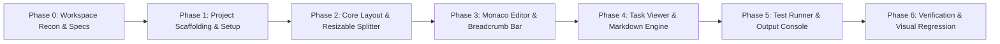

# Project Specification: High-Fidelity CodeChef Coding Practice Workspace

## 1. Executive Summary & Objective

The objective of this project is to build an elite, pixel-perfect, production-grade coding assessment and practice workspace inspired by the official CodeChef examination and submission portal (captured in the supplied reference screenshots from university lab assessments). 

The platform provides a dual-pane engineering interface combining an accessible, interactive problem statement viewer with a VS Code-grade Monaco code editor, dynamic breadcrumbs, multi-file tabbed IDE navigation, live countdown timers, section toggles (Coding vs. Viva), customizable test runners, and real-time execution feedback.

---

## 2. Comprehensive Reference Deconstruction (31 Screenshots)

From a forensic inspection of the 31 reference screenshots (`WhatsApp Image 2026-11-18 at 00.44.31` through `00.44.44`), the interface consists of the following key visual zones:

### 2.1. Top Navigation & Examination Bar
- **Candidate & Session Info (Left):**
  - Section Drawer / Menu toggle (`☰`).
  - Candidate status badge: `"Not Attempted"` (neutral slate dot), `"In Progress"` (amber pulse dot), `"Submitted"` (emerald dot).
  - Theme Toggle: Dark mode / Light mode toggle switch (crescent moon icon `🌙` / sun icon `☀️`).
  - Connectivity Indicator: Wi-Fi signal icon with green active bars and latency/status indicator.
  - Candidate Name display: e.g., `"BHAVISHYA PAL"`.
- **Exam Progress & Live Timer (Center):**
  - Section Label: e.g., `"Coding Section"` or `"Viva Section"`.
  - Countdown Clock: Distinct dual/triple numerical badges (e.g., `01 Hrs : 17 Min : 43 Sec` or `57 Min : 30 Sec`).
  - Warning State: High-contrast amber/rose flashing styling when under 10 minutes.
- **Action Controls (Right):**
  - `▶ Run` Button: Secondary outline/light button with play icon for compiling and running test cases.
  - `Submit` Button: Primary solid blue CTA button (`#1677ff` / `#0066cc`) for final code submission.
  - Contest Status Pill: e.g., `"Contest ends in 1h 2m"`.
  - Global Controls: Fullscreen expand toggle (`⛶`) and Editor refresh/reset button (`⟳`).

### 2.2. Left Activity Dock (Vertical Rail)
A slim, vertical icon rail positioned on the left edge:
1. `☰` **Sections Drawer:** Overview of all questions in the test (Question 1, Question 2, Viva questions).
2. `ℹ` / `!` **Problem Statement:** Main view showing task instructions, rules, and input/output formats (active by default).
3. `📁` **File Explorer:** Project hierarchy tree (`src/main/java/com/swingquiz/...`).
4. `⪢` **Test Suite / Submissions:** Test case list, previous run attempts, execution status.
5. `↻` **Reset Code:** Revert current file or full project back to initial starter boilerplate.
6. `🌐` **Language & Docs:** Language selector (Java 17, Python 3.12, C++20, SQL) and documentation quick reference.
7. `>_` **Terminal / Console Dock:** Toggle the bottom console panel.
8. `💬` **Support / Feedback:** Proctor messaging or feedback modal.
9. **Candidate Avatar / Profile** at bottom.

### 2.3. Left Pane: Problem Statement / Task Viewer
- **Task Header:** Clean title ("Task" or "Statement") with clean semantic hierarchy.
- **Problem Description:** Rich formatted text with bold emphasis, highlighted inline code pills (`jdbc:sqlite::memory:`, `QuizDatabase.java`), and bullet points.
- **Code & Table Blocks:** High-contrast dark container boxes (`#1e1e1e` / `#111827`) with rounded borders for SQL schema statements and code samples.
- **Specifications:**
  - Supported operations (`ADD`, `GET`, `STOCK`, `LIST`).
  - Input Format & Output Format descriptions with strict precision rules (e.g. 2 decimal places).
- **Sample Input & Sample Output Cards:**
  - Monospace text in clean dark code blocks with copy-to-clipboard action.
- **Feedback & Rating Widget:**
  - `"Did you like the problem?"` widget with thumbs up (`👍`), thumbs down (`👎`), comment icon (`💬`), and helpful counter (`"2 users found this helpful"`).
- **Floating Navigation Action:**
  - Floating circular blue scroll-to-top button (`↑`).
- **Viva Section Mode (from `00.44.44.jpeg`):**
  - Section header `"Viva Section"`, conceptual questions, text response field or code explanation prompt, and case-sensitive search bar with previous/next navigation buttons (`▲ ▼`).

### 2.4. Resizable Splitter
- Smooth, draggable vertical divider separating the Problem pane and Code Editor.
- Visual hover and dragging indicators (`cursor: col-resize`).
- Panel snap collapse support and persistent layout memory via `localStorage`.

### 2.5. Right Pane: Monaco IDE & Code Editor
- **Multi-File Tab Bar:**
  - Tabs for open files (e.g., `QuizDatabase.java`, `QuizPanel.java`, `Main.java`).
  - File type icons (Java `J` badge in red, SQL `db`, Python `py`, etc.).
  - Active tab highlighting with subtle top/bottom accent border and close icon (`×`).
  - Tab controls on right: Split editor icon (`[ | ]`), context options menu (`...`), and file refresh.
- **Breadcrumbs Bar:**
  - Hierarchical breadcrumbs trail: `JdbcQuizLab > src > main > java > com > swingquiz > QuizDatabase.java`.
  - Clickable path segments for quick folder jumping.
- **Monaco Code Editor Core:**
  - High-performance editor with VS Code-grade engine.
  - Multi-language syntax highlighting (Java, SQL, Python, C++, TypeScript).
  - Code folding markers, line numbers, cursor position indicator (Ln 57, Col 14).
  - Fill-in-the-blank exam support with predefined fill markers (`__________;`) and guided `// TODO:` comments matching university assessment templates.
  - Code search & replace (`Ctrl+F`), format document (`Shift+Alt+F`), bracket pair colorization.

### 2.6. Bottom Expandable Panel: Console & Test Runner
- **Drawer Tabs:**
  - `Test Cases`: Standard public test cases (Test 1, Test 2, Hidden Test 3) with Pass/Fail badges, run times, and memory metrics.
  - `Custom Input`: Interactive input box allowing custom stdin values.
  - `Execution Output`: Raw stdout/stderr terminal output with ANSI color support.
  - `Diff Viewer`: Side-by-side or inline expected vs. actual output comparison for failed assertions.
- **Resizer:** Horizontal draggable bar to expand or minimize the bottom console drawer.

---

## 3. Core Functional Requirements & User Stories

| ID | Requirement | User Story | Acceptance Criteria |
|:---|:---|:---|:---|
| **REQ-1** | Dual-Pane Responsive Workspace | As a student practicing coding, I want a split view of the problem statement and my code editor. | Dragging the divider smoothly resizes both panes. Snap-to-collapse works. Layout state persists. |
| **REQ-2** | Multi-File IDE Navigation | As a developer, I need to work across multiple project files (`Main.java`, `QuizPanel.java`, etc.). | Tabs allow switching active files, opening new files, closing tabs, and seeing file breadcrumbs. |
| **REQ-3** | VS Code / Monaco Integration | As a coder, I expect syntax highlighting, auto-complete, line numbers, and indentation. | Monaco editor loads with proper language worker, light/dark themes, and keyboard shortcuts. |
| **REQ-4** | Live Exam Countdown & Sections | As an examinee, I need to monitor my remaining time and switch between Coding and Viva sections. | Live countdown timer updates every second. Warning banner triggers under 10m. Mode switch swaps question view. |
| **REQ-5** | Code Execution & Test Runner | As a candidate, I want to run my code against test cases and see pass/fail results. | Clicking `▶ Run` executes simulation/compilation, showing stdout and assertion results in the bottom drawer. |
| **REQ-6** | Theme Switching | As a user, I want both Dark mode (OLED/VS Code dark) and Light mode (CodeChef clean light). | Clicking moon/sun instantly toggles theme across editor, task statement, and chrome without layout shift. |
| **REQ-7** | Fill-in-the-Blank Support | As a student taking a fill-in-the-blank assessment, I want guided blanks and validation. | Template contains editable blank fields with quick navigation between TODO targets. |

---

## 4. UI/UX Design System & Anti-Slop Directive

To ensure the product feels like an elite, \$150k+ custom engineering build rather than a generic boilerplate AI prototype, the UI adheres strictly to the installed `frontend-design`, `high-end-visual-design`, and `ui-ux-pro-max` design systems:

1. **Typography Hierarchy:**
   - Display & UI Headings: Clean, modern grotesque or system sans (e.g. `Geist`, `Plus Jakarta Sans`, or `Segoe UI`).
   - Monospace & Code: High-legibility coding font (`JetBrains Mono`, `Fira Code`, or Monaco).
   - Strict avoidance of generic, low-contrast typography.
2. **Color Architecture & Themes:**
   - **Light Mode (CodeChef Authenticity):** Crisp white background (`#ffffff`), slate borders (`#e2e8f0`), charcoal text (`#0f172a`), subtle grey toolbars (`#f8fafc`), primary blue accent (`#1677ff` / `#2563eb`).
   - **Dark Mode (Pro Dark IDE):** Deep slate-black canvas (`#0d1117` / `#161b22`), high-contrast syntax highlighting, glassmorphic floating tooltips.
3. **Double-Bezel & Micro-Interactions:**
   - Machined containers with inner highlights and subtle borders.
   - Smooth cubic-bezier transitions (`cubic-bezier(0.32, 0.72, 0, 1)`) for all drawer animations, accordion folds, and modals.
   - Accessible touch and click targets (minimum 40px hit area).
4. **Performance & Reliability:**
   - Zero layout shifts during editor resizing (using `ResizeObserver` and `editor.layout()`).
   - Sub-second hot-reload and fast client-side state transitions.

---

## 5. Development Phases

- **Phase 0:** Workspace recon, reference archive verification, skill installation and tech stack specification. *(Current Phase)*
- **Phase 1:** Project initialization (Vite + React 19 + TypeScript + Tailwind CSS v4 + Monaco Editor setup).
- **Phase 2:** Global layout scaffolding (Top Navigation, Left Activity Rail, Resizable Splitter Panes).
- **Phase 3:** Monaco Editor integration (multi-tab state management, breadcrumb navigation, language modes, theme synchronization).
- **Phase 4:** Task Viewer implementation (rich markdown rendering, sample code blocks, Viva mode, case-sensitive search, problem rating widget).
- **Phase 5:** Interactive test runner (mock compilation pipeline, custom input tab, test case assertions, diff inspector).
- **Phase 6:** Automated end-to-end verification, browser testing, accessibility audit, and visual regression.
